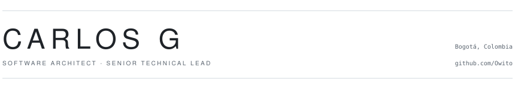
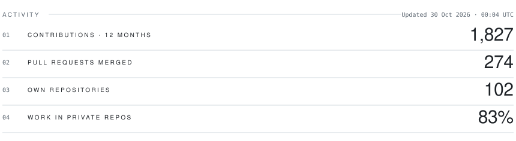
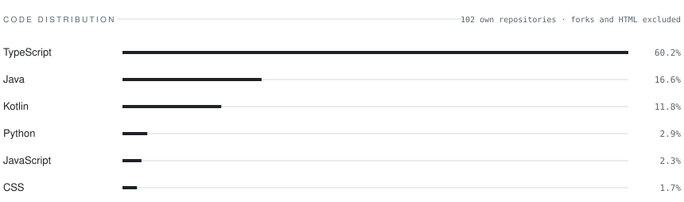

<picture>
  <source media="(prefers-color-scheme: dark)" srcset="assets/cover-en-dark.svg">
  
</picture>

<a href="README.md">Español</a> · English

I design and ship software for the financial sector and generative AI with measurable results: banking integrations, agents and evaluated RAG, on Java / Spring Boot, Python and TypeScript, across Azure, AWS or DigitalOcean. I also come from UX and educational technology, so I don't treat "it works" and "someone can actually use it" as separate problems: I write the Bicep for the environment and the user research that decides what gets built.

**Open to** Software Architecture, AI/GenAI Engineering and Cloud roles. 
[LinkedIn](https://www.linkedin.com/in/userpersona/) &nbsp;·&nbsp; [fgoguerra@gmail.com](mailto:fgoguerra@gmail.com)

<picture>
  <source media="(prefers-color-scheme: dark)" srcset="assets/stats-en-dark.svg">
  
</picture>

<picture>
  <source media="(prefers-color-scheme: dark)" srcset="assets/langs-en-dark.svg">
  
</picture>

These cards are queried against the GitHub API every three hours and committed to this repository (<a href="scripts/generate-stats.mjs"><code>scripts/generate-stats.mjs</code></a>), so they don't depend on any third-party service that can go down. The date marks when the numbers changed, not when the job ran. Programming languages only: markup doesn't count towards the split. No streaks: most of my work happens in private client repositories and in delivery cycles, not in daily commits.

## 01 · Selected work

#### [Agentic n8n auditing](https://github.com/Owito/Look-n8n-RedTeaming)

MCP servers that let an agent audit n8n workflows: SAST scanning, insecure patterns and a security dashboard. Its sibling, [Hydra-n8n-Auditor](https://github.com/Owito/Hydra-n8n-Auditor), proposes the patch.

Python · Model Context Protocol · SAST

#### [n8n-nodes-icd11](https://github.com/Owito/n8n-nodes-icd11)

Community node exposing the WHO ICD-11 API inside n8n. Shipped with trusted publishing over OIDC: no long-lived tokens in the pipeline.

TypeScript · n8n SDK · OIDC &nbsp;·&nbsp; <a href="https://www.npmjs.com/package/n8n-nodes-icd11">npm</a>

#### [Rehabilitación Continua CO](https://github.com/Owito/rehabilitacion-continua-co)

Directory of continuing education in rehabilitation. Three LLM providers failed the extraction, so the actual mechanism ended up being verified curation over sitemaps.

Astro · TypeScript · CI/CD &nbsp;·&nbsp; <a href="https://owito.github.io/rehabilitacion-continua-co/">live</a>

#### [Margoth](https://github.com/Owito/margoth)

Desktop application for cognitive and language rehabilitation. Fully offline by design: clinical data never leaves the machine.

Python · PyQt6 · Privacy by Design

#### [PoliMarket](https://github.com/Owito/polimarket-arquitectura)

Distributed component architecture with strict layer separation: a framework-free REST API in Go and a CLI client in Rust.

Go · Rust · Render &nbsp;·&nbsp; <a href="https://owito.github.io/polimarket-arquitectura/">live</a>

#### [Products API over gRPC](https://github.com/Owito/api-productos-grpc)

Backend with a protobuf contract and hexagonal architecture: the domain knows neither gRPC nor JPA.

Kotlin · Spring Boot · gRPC · JPA

#### [Caracter](https://github.com/Owito/caracter)

Audits an interface and puts a number on how generic it is. No backend and no telemetry: the whole analysis runs in the browser, so nobody sees the UI you are evaluating.

TypeScript · Art direction · No backend &nbsp;·&nbsp; <a href="https://owito.github.io/caracter/">live</a>

## 02 · How I work

**Infrastructure as code, or it doesn't count.** Bicep with a `what-if` pass first, Container Apps, secrets through Key Vault with Managed Identity. No secret lives in the repo.

**12-Factor as an exit criterion.** On the last backend I led, the service went from meeting 2 of the 12 factors to 9 before I called it deployable.

**Security comes before the pentest, not after.** On the last platform I hardened I closed 90% of the findings and validated them in production, not in a document.

**Tests where they change decisions.** A real pyramid by level, not vanity coverage.

**Privacy by Design.** When the data is sensitive, processing stays local: Margoth and my notes app run AI models fully offline.

## 03 · Stack

**Architecture and backend** 
Java (Spring Boot) · TypeScript · Kotlin · Python · Go · Rust 
DDD · Hexagonal architecture · Microservices · REST APIs · 12-Factor

**Cloud, DevOps and IaC** 
Azure (Container Apps, PostgreSQL, Key Vault, App Gateway) · AWS · DigitalOcean · Docker · Kubernetes 
Bicep · Terraform · Azure DevOps · GitHub Actions · Linux

**AI and automation** 
Multi-agent systems · MCP servers · RAG with pgvector and evaluation (Ragas) · Claude Code · Claude and Gemini APIs · n8n

**Frontend and UX** 
Astro · React · Jetpack Compose · JavaScript · CSS · Figma 
Nielsen's heuristics · Neurodiversity Design System · Accessibility

## 04 · Experience

**Independent Consultant · Software & AI Architect** · *2026 to present* 
Financial sector: Host-to-Host integration with a bank (ISO 20022, PGP, Entra ID), accounts payable and a 144-rule AI-assisted development standard; an evaluated RAG (95% hit@1 on 40 verified questions) and a microcredit platform in production since September 2026. Agents in the delivery cycle, always with human review before production.

**Technical Lead · Solvo (via Softgic)** · *2025 to 2026, 1 year* 
GenAI platform architecture on Azure, PostgreSQL migration to managed infrastructure, hardening and AI automation. From infrastructure design through to the pipeline.

**Senior Instructional Designer and Learning Platforms** · *2020 to 2024* 
Educational product and agile delivery at EFAE, Área Andina and FUNDEINCO.

**UX Developer · Orange Mia!** · *2023* 
Web development and user-centered research.

## 05 · Education

- **MSc in Software Architecture** · Politécnico Grancolombiano · *in progress*
- **BSc in Software Engineering** · Politécnico Grancolombiano · *in progress*
- **MSc in Educational Informatics** · Universidad de La Sabana
- **BSc in Speech and Language Pathology** · Universidad de Pamplona

## 06 · Contact

A role, a project, or a second opinion on an architecture? 
[fgoguerra@gmail.com](mailto:fgoguerra@gmail.com) &nbsp;·&nbsp; [LinkedIn](https://www.linkedin.com/in/userpersona/)
